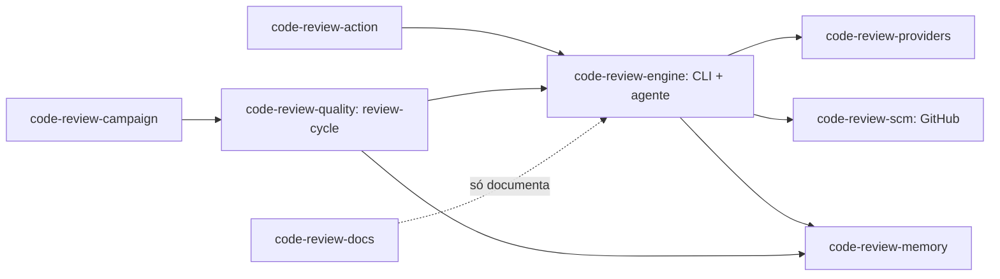

# 00 Hub - code-review

> [!tldr] Em linguagem comum
> É um revisor de código com IA que lê só o que mudou, procura defeitos em várias dimensões (correção, segurança, testes…), tenta derrubar as próprias suspeitas antes de mostrá-las e publica o parecer no terminal, num arquivo SARIF ou no pull request do GitHub. Por padrão ele só aconselha; bloquear o merge é uma escolha explícita.

← [[00 Hub - Ecossistema AgentsKit]]

## Para que existe e quem usa

O pacote npm `@agentskit/code-review` (`package.json:2`) entrega uma CLI (`agentskit-review`), uma GitHub Action composta (`action.yml:1`), uma API de biblioteca (`src/index.ts:1`) e quatro comandos de orquestração (`package.json:7`). O provedor de IA é intercambiável: CLIs locais logadas (Codex, Claude Code, Grok, OpenCode), Ollama local ou qualquer fábrica de [[agentskit-adapters]] (`src/cli.ts:409`).

| Público | Uso |
|---|---|
| Pessoa desenvolvedora | `agentskit-review --provider 
` no próprio diff (`src/cli.ts:174`) |
| Repositório no GitHub | Action consultiva em PR (`action.yml:120`) |
| Operação agendada (Orca/runner local) | `agentskit-review-campaign` → `agentskit-review-cycle` por PR, com publicação e merge opcionais (`scripts/review-campaign.mjs:103`) |
| [[00 Hub - harness]] | Produto irmão citado no README (`README.md:216`); que ele use o code-review como etapa de revisão não é verificável neste repo (ver o hub do harness) |
| Integradores da biblioteca | `createCodeReviewAgent`, reporters, contratos de campanha (`src/index.ts:113`) |

**Stack:** TypeScript ESM, Node ≥ 20 (`package.json:149`), Zod 4, [[agentskit-core]], [[agentskit-runtime]], [[agentskit-tools]], [[agentskit-net]], [[agentskit-cross-platform]], [[agentskit-ink]] (`package.json:127`); site Next.js 16 + Fumadocs em `apps/docs` (`apps/docs/package.json:13`).

## Partes e fluxos

| Nota | Papel |
|---|---|
| [[code-review-engine]] | CLI, agente de revisão, fontes, lentes, verificação adversarial, orçamentos e reporters. |
| [[code-review-providers]] | Registro de provedores, `doctor`, adaptadores de CLIs locais e Ollama, retry/circuit breaker. |
| [[code-review-scm]] | Contrato SCM neutro e a implementação GitHub (diff, estado de revisão idempotente, publicação, merge). |
| [[code-review-campaign]] | Revisão de vários PRs com preflight, leases e checkpoint; contratos e reducer de campanha. |
| [[code-review-memory]] | Feedback, candidatos a regra, regras aprovadas, cache de revisão e regras por linguagem. |
| [[code-review-quality]] | Ciclo de um PR (`review-cycle`), harness/canário, matriz de qualidade, fault injection e telemetria. |
| [[code-review-action]] | A GitHub Action composta. |
| [[code-review-docs]] | Site Fumadocs de apresentação e documentação; nunca executa revisões. |

| Fluxo | Resultado |
|---|---|
| [[Code Review - Da mudança ao parecer]] | Uma execução da CLI: fonte → pacotes de contexto → análise → verificação → relatório e código de saída. |
| [[Code Review - Ciclo completo de um PR]] | O `review-cycle` trava SHA e política, roda canário, avaliação de qualidade e A/B de memória, consolida lotes e só então publica ou faz merge. |
| [[Code Review - Retomar campanha e aprender]] | A campanha descobre PRs, executa com leases e checkpoint retomável, e o feedback vira candidato a regra (nunca regra ativa sozinho). |

| Guia | Quando usar |
|---|---|
| [[Guia code-review - Validar uma mudança]] | Antes de abrir PR neste repo. |
| [[Guia code-review - Publicar uma versão]] | Changesets → PR de versão → publish OIDC. |
| [[Guia code-review - Adicionar um provedor]] | Nova CLI local ou API. |
| [[Guia code-review - Rodar uma revisão]] | Revisão local, na Action ou em campanha agendada. |

Decisões: [[00 Decisões - code-review]] (10 ADRs aceitos). Auditoria da versão anterior: [[Auditoria - code-review]].

## Deploy e dados

- **npm:** publicado só por `publish.yml` após merge do PR `chore: version packages` do bot, com npm Trusted Publishing (OIDC) e `--provenance` (`.github/workflows/publish.yml:13`, `.github/workflows/publish.yml:95`).
- **Action:** roda de `$GITHUB_ACTION_PATH` com `npm ci` e `npm run review` (= `tsx src/cli.ts`, sem build) (`action.yml:77`, `action.yml:120`, `package.json:96`).
- **Site:** dois caminhos declarados — Vercel com raiz `apps/docs` (`apps/docs/README.md:3`) e Cloudflare Workers static assets via `npm run cf:deploy` (`apps/docs/wrangler.toml:1`, `apps/docs/package.json:11`). Não foi verificado qual está ativo.
- **Estado local:** campanhas e ciclos gravam JSON atômico em `execution.statePath` (padrão `.agentskit/review-state`) e em `.agentskit/review-runs/` (`src/public-config.ts:111`, `scripts/review-cycle.mjs:65`). Não há banco nem serviço remoto próprio.
- **Rede:** o provedor escolhido recebe o código-fonte (redigido quando a fronteira é remota/desconhecida, `src/cli.ts:127`); a API do GitHub recebe leituras e publicações (`src/github-api-client.ts:3`).

## CI e verificações declaradas

| Workflow | O que faz |
|---|---|
| `ci.yml` | Ubuntu, Node 22: `npm ci` (raiz e `apps/docs`), `docs:index` sem diff, `check:public-api`, `npm run check`, `test:coverage`, `npm pack --dry-run` (`.github/workflows/ci.yml:30`) |
| `release.yml` | Changesets cria/atualiza o PR de versão e aprova a execução (não o merge) de CI/CodeQL/dependency-review desse PR (`.github/workflows/release.yml:39`, `.github/workflows/release.yml:49`) |
| `publish.yml` | Publicação npm OIDC + GitHub Release imutável (`.github/workflows/publish.yml:93`) |
| `codeql.yml`, `dependency-review.yml`, `scorecard.yml` | Reusam workflows de [[00 Hub - .github]] fixados por SHA (`.github/workflows/codeql.yml:22`, `.github/workflows/dependency-review.yml:18`, `.github/workflows/scorecard.yml:15`) |

Comandos de validação objetivos (doc-bridge, `doc-bridge.config.json:35`): `npm run check`, `npm run docs:web:build`, `npm pack --dry-run`.

## Limites e divergências

- README e OPERATIONS ainda dizem `0.31.x`/`0.31.0` (`README.md:494`, `docs/OPERATIONS.md:620`); `package.json` está em `0.32.2` (`package.json:3`).
- O índice de ADRs diz que ADR-0008 mantém o padrão "pending a live A/B" (`docs/adr/README.md:14`), mas o próprio ADR e o código promoveram `conservative` a padrão (`docs/adr/0008-verification-posture.md:67`, `agents/code-review/agent.ts:472`).
- O executor de campanha em produção não usa o reducer puro nem as chaves de idempotência do checkpoint; ver [[code-review-campaign]] e [[Auditoria - code-review]].

> [!info]- Detalhe técnico
> - Pacote e binários: `package.json:2`, `package.json:7`, `package.json:14`.
> - Superfície pública: `src/index.ts:1`, `src/index.ts:113`, `src/index.ts:126`.
> - Seleção de provedor: `src/cli.ts:409`.
> - Handoff de agentes: `docs/for-agents/code-review.md:16`.
> - Fronteiras inegociáveis: `AGENTS.md:5`.
> - doc-bridge: um pacote (`package:@agentskit/code-review`), editRoot `.`, startHere `docs/for-agents/code-review.md` (`doc-bridge.config.json:40`).
