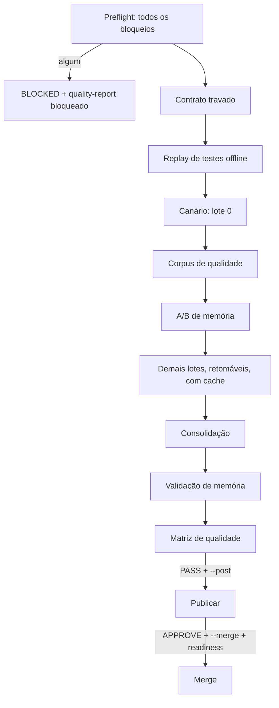

# Code Review - Ciclo completo de um PR

> [!tldr] Em linguagem comum
> É o roteiro "à prova de auditoria" para revisar um único pull request: antes de gastar com IA, confere tudo o que pode dar errado; trava a versão exata do código e das regras; testa num lote piloto; mede o revisor contra casos de resposta conhecida; revisa o resto em lotes que podem ser retomados; junta tudo, dá uma nota de qualidade e só então — se pedido e se a nota passar — publica o parecer e faz o merge.

← [[00 Hub - code-review]]

## Entrada e resultado

Comando `agentskit-review-cycle --repository o/r --pull N --config <abs> [--provider] [--mode] [--post] [--merge] [--admin]` (`scripts/review-cycle.mjs:62`). Resultado: `cycle-summary.json` sempre escrito (mesmo bloqueado), `decision: COMPLETE|BLOCKED`, exit 0 só para `COMPLETE` (`scripts/review-cycle.mjs:439`, `scripts/review-cycle.mjs:442`).

| Etapa | O que acontece | Evidência |
|---|---|---|
| Preflight | Config, schema, corpus, entradas, `gh auth`, rate limit ≥ 100, versão no npm, `doctor`, login do Codex, regras de merge, disco ≥ 100 MiB, PR aberto/não draft/não Dependabot/não fork, SHA estável, plano completo sem `UNREVIEWED`, lentes obrigatórias, PR ainda não revisado com essa política | `scripts/review-cycle.mjs:113`, `scripts/review-cycle.mjs:145`, `scripts/review-cycle.mjs:178`, `scripts/review-cycle.mjs:192`, `scripts/review-cycle.mjs:203` |
| Contrato | Grava `contract.json` com SHA, base, provedor, fingerprints (config, corpus, aprendizado, política, manifesto), orçamento; retomada com valor diferente falha | `scripts/review-cycle.mjs:220`, `scripts/review-cycle.mjs:222` |
| Replay | `review-harness --replay` roda testes offline (harness, lotes, matriz, CLI smoke) | `scripts/review-cycle.mjs:243`, `scripts/review-harness.mjs:96` |
| Canário | Primeiro lote; validado por `validateCanary` | `scripts/review-cycle.mjs:334`, `src/harness.ts:110` |
| Qualidade | Cada caso do corpus via `--stdin`, pontuado contra gabarito | `scripts/review-cycle.mjs:339`, `scripts/review-cycle.mjs:642` |
| A/B de memória | Mesmo caso com e sem a regra aprovada do corpus de aprendizado | `scripts/review-cycle.mjs:342`, `scripts/review-cycle.mjs:445` |
| Lotes | Pendentes em paralelo (`--batch-concurrency`, padrão 2); cache por identidade; retentativa só para falha transitória | `scripts/review-cycle.mjs:352`, `scripts/review-cycle.mjs:280`, `scripts/review-cycle.mjs:326` |
| Consolidação | CLI `--consolidate-manifest` aceita só o conjunto completo de lotes válidos | `scripts/review-cycle.mjs:362`, `src/batch-coverage.ts:95` |
| Memória | Persistência, rejeição de arquivo malformado, feedback `pending`, reconciliação, histórico | `scripts/review-cycle.mjs:483` |
| Matriz | `evaluateQuality` (ou contra baseline) → `PASS`/`BLOCKED` | `scripts/review-cycle.mjs:393` |
| Publicação | Só com `--post` e `PASS`; CLI `--publish-result` reconfere SHA e política | `scripts/review-cycle.mjs:407`, `src/cli.ts:285` |
| Merge | Só com `--merge`, `--post`, `PASS`, veredito `APPROVE`, `mergeReadiness` pronto e head = manifesto; senão `skipped:review-findings` ou erro | `scripts/review-cycle.mjs:414`, `src/github-scm-adapter.ts:214` |

## Falha e recuperação

- Qualquer exceção vira `problems[]` e o resumo é escrito no `finally`, com `quality-report.json` bloqueado se a matriz não chegou a ser gerada (`scripts/review-cycle.mjs:429`, `scripts/review-cycle.mjs:434`).
- Reexecutar com o mesmo `--run-dir`/`--run-id` retoma: lotes válidos com hash conferido não rodam de novo (`scripts/review-cycle.mjs:300`); o prazo global não reinicia (`scripts/review-cycle.mjs:227`).
- SIGINT/SIGTERM abortam os filhos (SIGTERM, depois SIGKILL em 5 s) (`scripts/review-cycle.mjs:43`, `scripts/review-cycle.mjs:707`).
- Orçamento global esgotado impede novas chamadas (`scripts/review-cycle.mjs:592`).

| Quem atua | Papel |
|---|---|
| [[code-review-quality]] | Dono do roteiro, harness e matriz |
| [[code-review-engine]] | Cada invocação filha da CLI |
| [[code-review-scm]] | Metadados, estado, readiness e merge |
| [[code-review-memory]] | Cache, A/B e validação dos stores |
| [[code-review-campaign]] | Chama este ciclo uma vez por PR |

> [!info]- Detalhe técnico
> - Para operação direta, supervise exit code, identidade do resumo, estado completo dos lotes e decisão de qualidade; use um run-dir novo para SHA ou política nova (`docs/OPERATIONS.md:353`).
> - `--merge` exige execução a partir do pacote publicado (não de um checkout de fonte) com tag `v<versão>` existente; isso entra como `releasePass` na área `integration` da matriz, que precisa passar (`scripts/review-cycle.mjs:154`, `scripts/review-cycle.mjs:388`).
