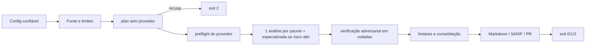

# Code Review - Da mudança ao parecer

> [!tldr] Em linguagem comum
> Uma execução do revisor: ele descobre o que mudou, separa em pacotes pequenos, pede à IA uma análise, manda outras chamadas tentarem derrubar cada suspeita, filtra o que é fraco e entrega o parecer — com um código de saída que o CI pode usar para bloquear ou só aconselhar.

← [[00 Hub - code-review]]

## Entrada e resultado

Entrada: flags da CLI (ou inputs da [[code-review-action]]), `.agentskit-review.json` ou `--config`, e uma fonte (diff local, PR, caminhos, stdin, snapshot). Resultado: Markdown no stdout, opcionalmente SARIF, `--result` privado e review no PR; exit `0` (limpa), `1` (bloqueio) ou `2` (incompleta/erro) (`src/cli.ts:401`).

| Etapa | O que acontece | Evidência |
|---|---|---|
| 1. Configuração | `.agentskit-review.json` ou config pública; em CI, provider/model/transport/context/trustMode/redaction/permissions do arquivo são proibidos; `trusted-local` e `--allow-*` proibidos | `src/cli.ts:206`, `src/review-config.ts:158`, `src/review-config.ts:162` |
| 2. Fonte | `--pr` (exige `GITHUB_TOKEN`), `--stdin`, `--paths`, snapshot isolado ou `git diff origin/main...HEAD`; redação se fronteira remota/desconhecida | `src/cli.ts:138`, `src/cli.ts:127` |
| 3. Estado no GitHub | Com `--post`: fork → `SKIPPED` e exit 2; mesma SHA+política já publicada → `SKIPPED`; marcador anterior "atrás" → revisão incremental | `src/cli.ts:270`, `src/cli.ts:275`, `src/cli.ts:279` |
| 4. Tokens de SCM saem do ambiente | `GITHUB_TOKEN`, `GH_TOKEN`, `GITLAB_TOKEN` apagados antes do provedor | `src/cli.ts:257` |
| 5. Plano | Carrega alvos, agrupa (teste↔implementação, imports locais), mede cada pacote com `compileBudget`, divide arquivo grande; recusa se exceder arquivos, bytes, tokens ou chamadas | `agents/code-review/agent.ts:1372`, `agents/code-review/agent.ts:844`, `agents/code-review/agent.ts:1302` |
| 6. Preflight do provedor | Para CLIs locais: `doctor` com smoke test se `health-check=auto` | `src/cli.ts:453` |
| 7. Análise | Uma chamada `submit_batched_findings` por pacote; risco `high`/`critical` acrescenta uma especializada; achados fora de linha alterada são rejeitados pelo schema | `agents/code-review/agent.ts:950`, `agents/code-review/risk.ts:48`, `agents/code-review/agent.ts:964` |
| 8. Verificação | Lotes de até 8 achados; rodada 2 para `high`+ e `med` pouco confiantes; rodada 3 se as duas primeiras divergirem; sem veredito ⇒ `unverified` (aparece no relatório e torna a revisão incompleta) | `agents/code-review/agent.ts:1103`, `agents/code-review/agent.ts:1181` |
| 9. Limiar e consolidação | Severidade/confiança mínimas, máximo por arquivo; uma chamada junta duplicados entre lentes (falha = segue sem consolidar) | `agents/code-review/agent.ts:1228`, `agents/code-review/agent.ts:1073` |
| 10. Síntese | `incomplete` ⇒ `COMMENT`; sem achados ⇒ `APPROVE`; `high`+ ⇒ `REQUEST CHANGES`; prazo estourado liga `blocking` | `agents/code-review/agent.ts:1262`, `agents/code-review/agent.ts:1265` |
| 11. Reporters | Markdown sempre; SARIF com `--sarif`; com `--post`, review (inline só em linhas do diff) e resumo; revisão incompleta vai sem marcador | `src/cli.ts:296`, `agents/code-review/reporters.ts:215` |
| 12. Saída | `incomplete` ⇒ 2; `blocking` sem `--no-fail` ⇒ 1; senão 0; exceção ⇒ 2 | `src/cli.ts:401`, `src/cli.ts:542` |

## Falha e recuperação

- Autenticação recusada pelo provedor encerra todas as chamadas restantes (`agents/code-review/agent.ts:691`).
- Pacote sem nenhuma lente bem-sucedida (fora do caso de prazo) lança `ReviewExecutionError` (`agents/code-review/agent.ts:1504`).
- Prazo: análises que terminaram são preservadas; o que faltou vira `UNREVIEWED` com motivo (`agents/code-review/agent.ts:1546`).
- SIGINT/SIGTERM abortam o `AbortController` da execução e chegam ao subprocesso do provedor (`src/cli.ts:536`).
- Publicação no GitHub reconcilia pelo marcador antes de repetir (`src/github-scm-adapter.ts:162`).

| Quem atua | Papel |
|---|---|
| [[code-review-engine]] | Etapas 1–12 |
| [[code-review-providers]] | Etapas 6–9 (adaptador e resiliência) |
| [[code-review-scm]] | Etapas 2, 3 e 11 |
| [[code-review-memory]] | Regras aprovadas e por linguagem entram no prompt na etapa 5 |

> [!info]- Detalhe técnico
> - Lotes externos (`--plan --batch-size`, `--batch-index`, `--consolidate-manifest`, `--publish-result`) dividem esta mesma execução em várias; ver [[Code Review - Ciclo completo de um PR]].
> - Na Action, `--block` padrão é `high` e `--no-fail` é acrescentado a menos que `fail-on-block` seja `true` (`action.yml:35`, `action.yml:119`).
