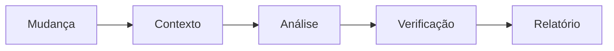

# Code Review - Da mudança ao parecer

> [!tldr] Em linguagem comum
> O código alterado é analisado por IA, as suspeitas são verificadas e o resultado pode bloquear o CI ou sair como recomendação.

← [[00 Hub - code-review]]

## O que acontece

1. [[code-review-engine]] resolve fonte (diff, PR, paths ou stdin), configuração e provedor; valida orçamento antes das chamadas.
2. Monta pacotes de contexto limitados, com redação em fronteira remota/desconhecida. Arquivo excluído ou grande demais vira UNREVIEWED.
3. Agente analisa lentes habilitadas; risco alto/crítico recebe profundidade adicional. Suspeitas passam por verificação adversarial e filtros.
4. Resultado informa dimensões ausentes/incompletas; ausência de prova não é revisão limpa.
5. Reporters produzem Markdown/SARIF; --post em PR usa GitHub e permissões próprias. Severidade e política definem falha de CI.

| Limite da evidência | Resultado |
|---|---|
| Escopo | Sequência reconstruída de código e docs de [[00 Hub - code-review]]; não executada nem confirmada em produção |

> [!info]- Detalhe técnico
> - `code-review/src/cli.ts:139`.
> - `code-review/src/cli.ts:297`.
> - `code-review/agents/code-review/agent.ts:1`.
> - `code-review/agents/code-review/reporters.ts:1`.
> - `code-review/action.yml:1`.
