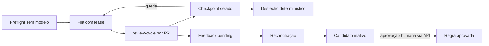

# Code Review - Retomar campanha e aprender

> [!tldr] Em linguagem comum
> Uma campanha percorre todos os PRs abertos de um repositório, revisa os elegíveis um a um e anota o andamento em disco; se o processo cair, recomeça de onde parou sem refazer o que terminou. O que as pessoas disserem sobre os achados fica guardado como feedback e pode virar sugestão de regra — mas uma sugestão nunca entra em uso sem aprovação.

← [[00 Hub - code-review]]

## Entrada e resultado

`agentskit-review-campaign --config <arq> [--output] [--quality-output] [--pull N] [--mode] [--post] [--merge] [--preflight-only]` (`scripts/review-campaign.mjs:60`). Resultado: relatório de campanha com desfecho por PR e `COMPLETE|PARTIAL|BLOCKED|CANCELLED`, mais uma matriz de qualidade de campanha (`scripts/review-campaign.mjs:139`).

| Etapa | O que acontece | Evidência |
|---|---|---|
| Configuração e bloqueios globais | Config validada; só SCM `github`; credencial GitHub; baseline de qualidade existente | `scripts/review-campaign.mjs:62`, `scripts/review-campaign.mjs:72` |
| Preflight | Descobre PRs abertos (ou só `--pull`), aplica elegibilidade, verifica marcador, planeja sem modelo; `worktreeAllowed` só se tudo pronto | `src/campaign-preflight.ts:56`, `src/campaign-preflight.ts:77`, `src/campaign-preflight.ts:132` |
| Identidade | `campaignId` = hash de fingerprint de execução (config + modo), versão do pacote e preflight estável | `scripts/review-campaign.mjs:84` |
| Fila | `maxConcurrentPullRequests` trabalhadores; lease da campanha + lease por PR com heartbeat | `src/campaign-runner.ts:126`, `src/campaign-runner.ts:145`, `src/campaign-runner.ts:180` |
| Execução por PR | Escreve `orca-evidence.json`, reusa ciclo já `COMPLETE`, senão roda `review-cycle` filho | `scripts/review-campaign.mjs:97`, `scripts/review-campaign.mjs:100`, `scripts/review-campaign.mjs:103` |
| Checkpoint | Cada mudança de estado grava o relatório selado sob lease | `src/campaign-runner.ts:133` |
| Desfecho | Pendentes restantes viram `CANCELLED`; campanha `COMPLETE` sem bloqueados, `BLOCKED` se todos, `PARTIAL` se alguns | `src/campaign-runner.ts:185`, `src/campaign-runner.ts:63` |
| Feedback | O ciclo grava cada achado consolidado como feedback `pending`, uma vez por execução | `scripts/review-cycle.mjs:508` |
| Reconciliação | Feedback `accepted`/`fixed` com ≥ 2 ocorrências do mesmo achado vira candidato `active: false` | `src/review-feedback.ts:102`, `src/review-feedback.ts:116` |
| Aprovação | Só por chamada explícita a `saveApprovedRule` (nenhum comando do repo faz isso) | `src/review-stores.ts:166` |

## Falha e recuperação

- Execução interrompida: entradas `running` voltam a `pending` com motivo "resumed after interrupted execution" (`src/campaign-runner.ts:114`).
- Checkpoint ilegível: todos os PRs não terminais viram `BLOCKED` com o erro (`src/campaign-runner.ts:106`).
- Lease já tomado: a campanha termina `BLOCKED` sem executar (`src/campaign-runner.ts:127`).
- Falha num PR: `BLOCKED` para ele; com `continueAfterPerPrFailure: false`, os demais viram `CANCELLED` (`src/campaign-runner.ts:171`).
- Falha ao gravar o relatório final: `campaignReportDeliveryFailed` devolve estado `running` com erro, e exit 2 (`scripts/review-campaign.mjs:146`).

| Quem atua | Papel |
|---|---|
| [[code-review-campaign]] | Preflight, fila, leases, checkpoint |
| [[code-review-quality]] | Ciclo por PR e matriz de campanha |
| [[code-review-memory]] | Feedback, reconciliação e regras aprovadas |
| [[code-review-scm]] | Descoberta e estado de revisão |

> [!info]- Detalhe técnico
> - As chaves de efeito externo (`recordExternalEffect`) e o reducer de eventos **não** participam deste fluxo; a idempotência de publicação vem do marcador no GitHub ([[code-review-scm]]) e a de lotes, do cache e dos metadados de artefato do ciclo.
> - Desfechos por PR executado neste comando: `APPROVED` ou `CHANGES_REQUESTED` (`scripts/review-campaign.mjs:109`); `SKIPPED`/`BLOCKED` vêm do preflight (`src/campaign-runner.ts:58`).
