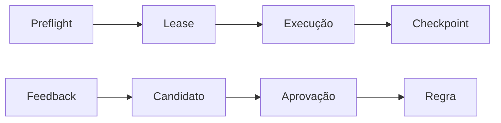

# Code Review - Retomar campanha e aprender

> [!tldr] Em linguagem comum
> Uma campanha salva o andamento de cada PR e mantém aprendizados separados da execução, para poder retomar com segurança.

← [[00 Hub - code-review]]

## O que acontece

1. Preflight de [[code-review-campaign]] identifica PRs elegíveis e revisões/políticas.
2. Executor adquire leases, limita concorrência e persiste checkpoints com fingerprint.
3. Retomada valida identidade e continua pendências; efeitos externos usam chaves de idempotência. Relatório agrega completo, parcial, bloqueado ou cancelado.
4. [[code-review-memory]] reconcilia feedback em candidatos inativos com proveniência.
5. Só regra aprovada entra na recuperação limitada por escopo; não há promoção automática de aprendizado.

| Limite da evidência | Resultado |
|---|---|
| Escopo | Sequência reconstruída de código e docs de [[00 Hub - code-review]]; não executada nem confirmada em produção |

> [!info]- Detalhe técnico
> - `code-review/src/campaign-runner.ts:11`.
> - `code-review/src/campaign-store.ts:1`.
> - `code-review/src/review-feedback.ts:1`.
> - `code-review/src/review-learning.ts:1`.
